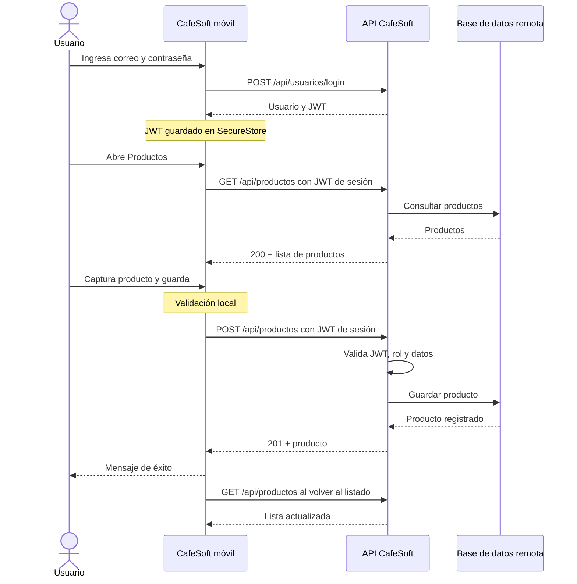
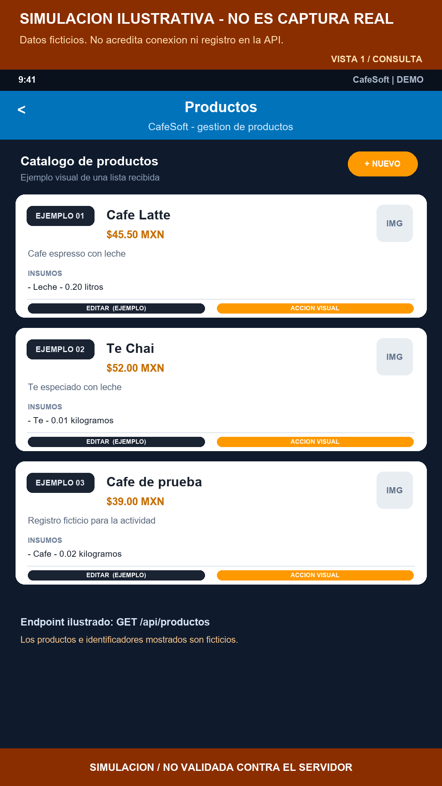
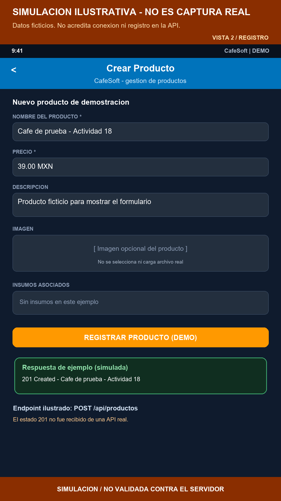
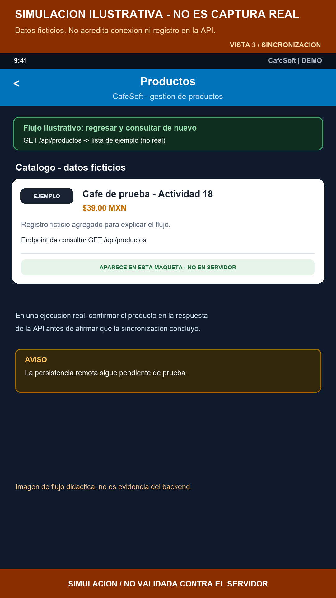
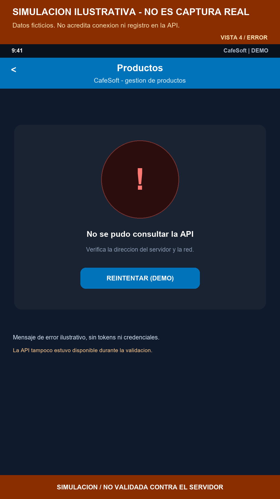

# Actividad 18: Sincronización de información entre una aplicación móvil y un servicio en la nube

**Proyecto:** CafeSoft
**Asignatura:** Desarrollo Móvil Integral
**Fecha de preparación de esta evidencia:** 9 de noviembre de 2026
**Entidad seleccionada:** Productos

> **Estado de evidencia:** la app y la integración están implementadas, pero
> las pruebas en vivo de consulta, registro y verificación remota no pudieron
> ejecutarse porque la API no estaba disponible en la red durante esta
> validación. Esos resultados se marcan como pendientes y no se presentan
> capturas simuladas.

## 1. Proyecto integrador actualizado

Se trabajó sobre la aplicación móvil existente de CafeSoft, desarrollada con
React Native y Expo SDK 54. La funcionalidad seleccionada es la **consulta y
sincronización de productos** con el servicio remoto.

La aplicación obtiene los productos del backend y permite registrar un
producto desde el formulario móvil. También permite editar productos mediante
`PUT`. Después de guardar, al regresar al listado, este vuelve a consultar los
datos del servidor. Los datos enviados incluyen nombre, precio, descripción,
imagen opcional e insumos asociados.

## 2. Repositorio y código fuente

- **Repositorio del proyecto móvil:** [CafeSoft_ReactNative](https://github.com/alanronaldosc-dev/CafeSoft_ReactNative)
- **Rama de la actividad:** `actividad-18-sincronizacion-movil`
- **Servicio remoto:** API CafeSoft en la rama [actividad-18-sincronizacion-movil](https://github.com/alanronaldosc-dev/ApiCoffeSoft_Java/tree/actividad-18-sincronizacion-movil) de `ApiCoffeSoft_Java`, Spring Boot.
- **Pantalla de listado y consulta:** `src/screens/ProductosListScreen.js`
- **Formulario, validación y registro/actualización:** `src/screens/ProductoFormScreen.js`
- **Servicio REST de productos:** `src/services/ProductoService.js`
- **Configuración del cliente HTTP y URL base:** `src/config/api.js`
- **Manejo de errores de API:** `src/services/apiRequest.js`

La aplicación genera correctamente el bundle web de Expo. El código fuente y
los cambios de integración se entregan en la rama indicada.

## 3. Servicio remoto y endpoints

El servicio remoto es la **API REST de CafeSoft**, desarrollada con Java y
Spring Boot. La URL base se configura con la variable
`EXPO_PUBLIC_API_URL`. El valor predeterminado configurado para desarrollo
local es:

```text
http://192.168.100.3:8080/api
```

En un teléfono físico, la URL debe apuntar a una dirección accesible desde la
misma red. `localhost` apuntaría al propio teléfono, no al equipo donde se
ejecuta la API. Se puede configurar antes de iniciar Expo, por ejemplo:

```powershell
$env:EXPO_PUBLIC_API_URL = "http://<IP_DEL_EQUIPO_API>:8080/api"
npx expo start --clear
```

| Método | Endpoint | Acceso | Función |
|---|---|---|---|
| `POST` | `/api/usuarios/login` | Público | Validar credenciales; devuelve datos de usuario y JWT. |
| `GET` | `/api/productos` | JWT válido | Recuperar productos y mostrarlos en el listado. |
| `GET` | `/api/productos/{id}` | JWT válido | Recuperar un producto por identificador. |
| `POST` | `/api/productos` | ADMIN, USER | Registrar un producto nuevo. |
| `PUT` | `/api/productos/{id}` | ADMIN, USER | Actualizar un producto existente. |
| `DELETE` | `/api/productos/{id}` | ADMIN, USER | Eliminar un producto existente. |
| `GET` | `/api/inventario` | JWT válido | Consultar insumos para asociarlos a un producto. |

Ejemplo del cuerpo enviado al crear un producto:

```json
{
  "nombre": "Producto de prueba",
  "precio": 45.5,
  "descripcion": "Registro para la actividad",
  "imagen": null,
  "insumos": []
}
```

El backend valida el nombre (obligatorio, máximo 100 caracteres), el precio
(obligatorio y no negativo) y la descripción (máximo 500 caracteres). Cada
insumo requiere un identificador, una cantidad de al menos `0.001` y una unidad
permitida (`litros`, `kilogramos` o `piezas`). La app aplica validaciones
equivalentes antes de enviar la solicitud.

## 4. Flujo de sincronización

1. El usuario abre el listado de productos.
2. La app solicita `GET /api/productos` y muestra los registros recibidos.
3. El usuario abre el formulario, captura los datos y, si corresponde,
   selecciona insumos del inventario.
4. Antes del envío, la app valida los datos requeridos.
5. Al guardar, envía `POST /api/productos` (o `PUT` para una edición).
6. La app informa el resultado y regresa al listado, que consulta de nuevo la
   API para mostrar el estado remoto actualizado.
7. Si la solicitud falla, la app presenta un mensaje de error; el listado
   ofrece una acción para reintentar la consulta.



## 5. Capturas y demostración

La demostración está delimitada y preparada para ejecutarse con la aplicación
y la API reales. La compilación de los bundles se verificó, pero durante esta
validación la API no aceptó conexiones en `192.168.100.3:8080` ni en
`localhost:8080`. Por ello, no se obtuvieron capturas reales de una consulta o
un alta remotas. Se incluyen cuatro **maquetas ilustrativas con datos
ficticios**, identificadas dentro de cada imagen como simulación. No son
capturas de la aplicación en ejecución, no demuestran una respuesta del
servidor y no deben presentarse como prueba de persistencia remota.

| Evidencia | Qué debe mostrar la captura real | Nombre sugerido | Estado |
|---|---|---|---|
| Consulta | Pantalla **Acciones → Productos** con productos recibidos de `GET /api/productos`. | `evidencia-01-consulta-productos.png` | Captura real pendiente; [maqueta ilustrativa](./evidence/actividad-18-simulacion/evidencia-01-consulta-simulada.png). |
| Registro | Formulario con datos de prueba y confirmación de éxito del `POST /api/productos`. | `evidencia-02-registro-producto.png` | Captura real pendiente; [maqueta ilustrativa](./evidence/actividad-18-simulacion/evidencia-02-registro-simulado.png). |
| Sincronización | Listado abierto de nuevo con el producto recién creado recibido desde el servidor. | `evidencia-03-producto-sincronizado.png` | Captura real pendiente; [maqueta ilustrativa](./evidence/actividad-18-simulacion/evidencia-03-sincronizacion-simulada.png). |
| Validación o error | Mensaje al enviar datos inválidos o al fallar la conexión, sin credenciales visibles. | `evidencia-04-validacion-o-error.png` | Captura real pendiente; [maqueta ilustrativa](./evidence/actividad-18-simulacion/evidencia-04-error-simulado.png). |

### Maquetas visuales (no son evidencia de ejecución)

Las imágenes siguientes se pueden usar para explicar visualmente el flujo en
la presentación. No sustituyen las capturas reales que faltan ni cambian los
resultados pendientes de la matriz de pruebas.

<p align="center">
  
  
</p>
<p align="center">
  
  
</p>

### Guion para obtener las evidencias

1. Inicia el backend y configura `EXPO_PUBLIC_API_URL` con una dirección
   alcanzable desde el teléfono. Inicia Expo y entra con una cuenta de prueba
   autorizada (`ADMIN` o `USER` para registrar).
2. Abre **Acciones → Productos**. Espera la respuesta del servidor y toma la
   evidencia 1.
3. Pulsa **+ Crear Nuevo Producto**, registra un producto ficticio con nombre y
   precio válidos y guarda. Confirma el mensaje de éxito y toma la evidencia 2.
4. Vuelve al listado, que consulta los datos al recuperar el foco. Confirma que
   el producto creado aparece y toma la evidencia 3.
5. Deja vacío el nombre o ingresa un precio inválido para mostrar la validación
   local. Alternativamente, desconecta la API y pulsa **Reintentar** en el
   listado para mostrar el error de conexión. Toma la evidencia 4.

Las evidencias 1–3 deben corresponder al backend real de pruebas. No ejecutar
altas en producción. Oculta correos, tokens, contraseñas, direcciones privadas
y otros datos personales antes de entregar las capturas.

## 6. Matriz de pruebas

| # | Prueba | Resultado esperado | Resultado observado |
|---|---|---|---|
| 1 | Consultar productos existentes (`GET`) | Mostrar los registros remotos. | **Implementado; ejecución en vivo pendiente.** El 9-nov-2026 el host `192.168.100.3:8080` no aceptó conexión. |
| 2 | Crear producto válido (`POST`) | API confirma y la app muestra éxito. | **Implementado; ejecución en vivo pendiente** porque la API no está disponible. |
| 3 | Consultar después de registrar | El producto aparece en el listado actualizado. | **Implementado:** el listado consulta en foco al volver a la pantalla; observación remota pendiente de API disponible. |
| 4 | Enviar datos incompletos/inválidos | App evita enviar y explica el campo inválido; API valida también. | **Implementado en código:** validaciones de nombre, precio, descripción e insumos. Falta ejecutar y capturar en dispositivo. |
| 5 | Error de conexión/respuesta fallida | Mensaje genérico sin secretos y posibilidad de reintentar. | **Implementado en código.** Se confirmó que el host no responde; falta capturar la alerta/listado de error desde la app. |
| 6 | Build Expo para web y bundle Android | Bundles terminan sin errores. | **Aprobada:** `npx expo export --platform web --max-workers 1` y `npx expo export --platform android --max-workers 1` terminaron y exportaron `dist`. Android requirió limitar workers por memoria. |
| 7 | Expo dependency check | Dependencias compatibles con SDK instalado. | **Aviso:** Expo CLI detecta `expo@54.0.34` y recomienda `~54.0.37`; el bundle sí compiló. No se actualizaron dependencias en esta actividad. |
| 8 | Autorización de operaciones de producto | Lectura autenticada; escrituras solo para personal autorizado. | **Aprobada en pruebas MockMvc:** 7 pruebas de `SecurityConfigTest`, incluidas lectura por `CLIENT`, denegación de `POST`/`PUT`/`DELETE` a `CLIENT` y escritura permitida a `USER`. |

Las pruebas 1–5 no se marcan como aprobadas en runtime hasta ejecutarlas con el
backend activo y accesible desde el dispositivo. Las pruebas de build y de
autorización verifican aspectos técnicos, pero no sustituyen la comprobación
remota desde el teléfono. Se incluyen maquetas simuladas claramente
identificadas; no se obtuvieron capturas reales de la API.

## 7. Medidas de seguridad y limitaciones

- **Validación:** la app comprueba los datos antes del envío y el backend aplica
  validaciones al recibir el producto.
- **Manejo de errores:** se presentan mensajes entendibles sin mostrar
  credenciales ni detalles internos de la API.
- **Autenticación real:** `POST /api/usuarios/login` valida las credenciales y
  devuelve un JWT. La app lo guarda con `expo-secure-store` y el interceptor de
  Axios lo adjunta en el encabezado de autorización como token Bearer.
- **Autorización en el servidor:** la configuración Spring Security requiere
  autenticación para `/api/**` salvo rutas públicas explícitas. La lectura del
  catálogo requiere JWT válido. Crear, modificar y eliminar productos requiere
  los roles `ADMIN` o `USER`; el backend deniega estas escrituras a otros roles.
- **Pruebas de roles:** se añadieron pruebas MockMvc que permiten leer el
  catálogo a `CLIENT` autenticado, deniegan a `CLIENT` las operaciones
  `POST`/`PUT`/`DELETE` y verifican acceso de escritura para `USER`.
- **HTTPS:** no se encontró un endpoint HTTPS disponible para este entorno. La
  URL de desarrollo usa HTTP; para una red pública o despliegue debe publicarse
  la API detrás de TLS y configurar la URL `https://…`. No enviar credenciales
  por HTTP en redes públicas.
- **Alcance de validación:** estas medidas se verificaron en el código. No fue
  posible probar login, JWT o autorización en vivo durante esta ejecución
  porque el servidor API no estaba disponible.

## 8. Explicación del equipo

> En CafeSoft seleccionamos los productos como entidad para sincronizar. La
> aplicación móvil consulta los registros mediante `GET /api/productos` y
> permite crear productos mediante `POST /api/productos`. Antes de enviar,
> valida que los datos cumplan las reglas del formulario y de la API. Cuando el
> servidor confirma la operación, la app vuelve al listado y consulta otra vez
> para mostrar la información actualizada. También se implementó la
> actualización mediante `PUT`. Si ocurre un error de conexión o el servidor
> rechaza una solicitud, la app informa el problema sin mostrar datos
> sensibles. El servidor valida el JWT recibido en las operaciones protegidas;
> la app usa SecureStore para conservarlo y no confía únicamente en la
> selección de controles de la interfaz. La conexión local disponible usa
> HTTP, por lo que para un despliegue público se debe configurar HTTPS. La
> integración está implementada, pero las pruebas de consulta, registro y
> verificación en vivo deben repetirse cuando el backend esté encendido.

## 9. Lista de entrega

- [x] Proyecto móvil actualizado y código fuente en el repositorio.
- [x] Identificación del servicio remoto y sus endpoints.
- [x] Flujo de consulta, registro y actualización descrito y guion de
      demostración incluido.
- [ ] Capturas reales de consulta, registro y verificación posterior (pendientes
      porque la API no estuvo disponible durante la validación).
- [x] Matriz de pruebas con los resultados observados y pendientes claramente
      diferenciados.
- [x] Descripción de las medidas de seguridad y sus limitaciones actuales.
- [x] Explicación del flujo de sincronización.

## 10. Guion corto para la demostración

1. Inicia el backend Java y Expo, configurando `EXPO_PUBLIC_API_URL` con una
   dirección accesible desde el teléfono. Usa una cuenta de prueba autorizada.
2. Inicia sesión. Explica que el endpoint de login devuelve el JWT y que la app
   lo guarda en SecureStore; no muestres el token.
3. Abre **Acciones → Productos** y espera a que cargue el catálogo remoto.
   Toma la captura 1.
4. Pulsa **+**, registra un producto ficticio con nombre y precio válidos y
   guarda. Muestra el mensaje de éxito y toma la captura 2.
5. Al volver al listado, espera la recarga, localiza el producto creado y toma
   la captura 3. Para demostrar persistencia, consulta el mismo endpoint con
   autorización en el backend/herramienta API sin mostrar el bearer token.
6. Intenta guardar un formulario incompleto y muestra la validación local; como
   alternativa, detén la API y pulsa **Reintentar** para mostrar el error de
   conexión. Toma la captura 4.
7. Cierra diciendo que el backend aplica validación adicional; las llamadas a
   productos requieren JWT. Indica que el despliegue externo debe usar HTTPS.

No ejecutar el alta en producción. Las capturas deben ser de una sesión real
contra un backend de pruebas y no deben incluir información sensible. Para
cerrar la evidencia visual de la actividad, faltan únicamente las capturas
reales indicadas en la sección 5, que dependen de que la API esté encendida y
sea accesible desde el teléfono.
